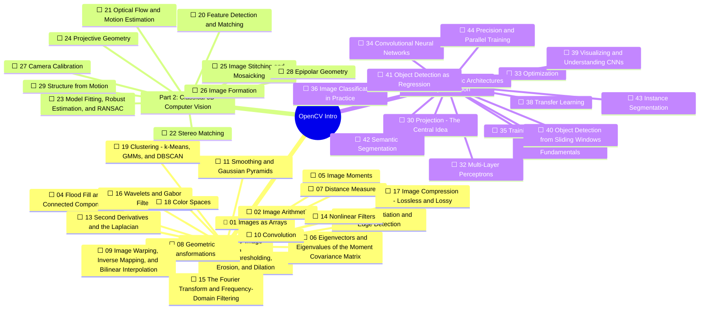

# Roadmap

Auto-generated from [syllabus.json](syllabus.json) and notebook status by `python tools/cvtool.py sync`.
Legend: ✅ done · 🚧 in progress · ⬜ todo

<!-- mindmap:start -->

<!-- mindmap:end -->

## Learning arc

| Part | Theme | Why it matters |
|---|---|---|
| I | Pixels, filters, features of a single image | Foundation for every later step; the OpenCV everyday toolkit |
| II | Geometry across views: matching, stereo, calibration, SfM | Robotics, AR, 3D reconstruction |
| III | Learned representations: CNNs, detection, segmentation | Modern production CV |
